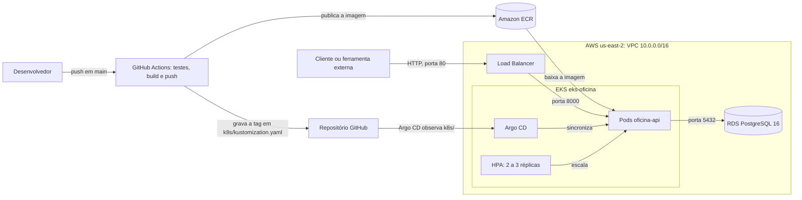

# API Oficina Mecânica

API em Python (FastAPI) para a gestão de uma oficina mecânica: ordens de serviço, clientes,
veículos, serviços e peças com controle de estoque. Usa DDD, Clean Architecture e PostgreSQL.

## API publicada

Ambiente da Fase 2 na AWS (EKS, região `us-east-2`):

| Recurso | Link |
|---|---|
| Swagger | <http://a3823b4683dee4d18a7ee9d3415c4632-226675440.us-east-2.elb.amazonaws.com/docs> |
| Collection (OpenAPI) | <http://a3823b4683dee4d18a7ee9d3415c4632-226675440.us-east-2.elb.amazonaws.com/openapi.json> |
| Saúde | <http://a3823b4683dee4d18a7ee9d3415c4632-226675440.us-east-2.elb.amazonaws.com/health> |

Para usar a collection, importe o link do `openapi.json` no Postman ou no Insomnia. Neste ambiente
não há dados de exemplo: cadastre um usuário em `POST /users/register`. Veja como autenticar em
[APIs](#apis).

## Objetivos

- **Fase 1 — MVP:** back-end da oficina com JWT, validação de CPF/CNPJ e placa e testes
  automatizados.
- **Fase 2 — qualidade, resiliência e escalabilidade:** código sustentável (Clean Code, Clean
  Architecture/Hexagonal), APIs para a operação e integração com sistemas externos e
  infraestrutura automatizada (Docker, Kubernetes, Terraform e CI/CD). Andamento em
  [Estado da Fase 2](#estado-da-fase-2).

Detalhes: [`docs/fase1-plano-de-acao.md`](docs/fase1-plano-de-acao.md),
[`docs/fase2-plano-de-acao.md`](docs/fase2-plano-de-acao.md) e
[`docs/auditoria-conformidade.md`](docs/auditoria-conformidade.md).

## Como executar

Pré-requisitos: Docker e Docker Compose.

```bash
git clone <URL_DO_REPOSITORIO>
cd api-oficina-mecanica
docker compose up --build
```

Não é preciso configurar nada: o `docker-compose.yml` já traz credenciais de **desenvolvimento**
(tabela abaixo). Para trocá-las, copie `.env.example` para `.env` e edite (em produção, gere o
segredo com `openssl rand -hex 32`).

- API: <http://localhost:8000> · Swagger: <http://localhost:8000/docs>
- Logs: `docker compose logs -f api`
- Parar: `docker compose down` (use `-v` para apagar também os dados do PostgreSQL)

| Variável | Padrão no compose | Para que serve |
|---|---|---|
| `JWT_SECRET_KEY` | `segredo-jwt-somente-para-desenvolvimento` | Assina os tokens JWT; a aplicação **não sobe sem ela** |
| `JWT_ALGORITHM` / `JWT_EXPIRE_MINUTES` | `HS256` / `60` | Algoritmo e validade do token |
| `INTEGRACAO_API_KEY` | `chave-integracao-somente-para-desenvolvimento` | Cabeçalho `X-API-Key` das rotas `/integracoes` (sem ela, 503) |
| `SEED_DADOS_EXEMPLO` | `true` | Cria o cliente `nilson@example.com` (senha `senha123`) e um veículo de exemplo |
| `SQL_ECHO` | `false` | Imprime o SQL executado, para depuração |

Esses valores servem apenas para desenvolvimento e avaliação. Fora do Docker, exporte
`JWT_SECRET_KEY` (ou crie o `.env`) antes de iniciar a aplicação.

## Arquitetura

Clean Architecture / Arquitetura Hexagonal; a dependência sempre aponta para dentro:

| Camada | Papel | Pode importar |
|---|---|---|
| `domain/` | Entidades, objetos de valor (CPF/CNPJ, placa, status) e contratos dos repositórios | só `domain` |
| `application/` | Casos de uso e portas de serviços (`application/ports`: hash de senha, JWT, unidade de trabalho) | `domain` |
| `adapters/` | Implementações das portas: repositórios SQLAlchemy, BCrypt, JWT, configuração, seeders | `domain`, `application` |
| `presentation/` | API REST (rotas, schemas, conversores) e composição das dependências | `application`, `domain` e, só em `presentation/dependencies`, `adapters` |

A regra é verificada por `tests/unit/test_arquitetura.py`. A abertura de OS com peças e o
adicionar/remover insumo gravam a OS e a baixa de estoque numa **única transação**.

## APIs

Documentação interativa em `/docs` ([ambiente publicado](#api-publicada)). Cadastre-se em
`POST /users/register`, faça login em `POST /users/login` e envie
`Authorization: Bearer <token>`.

Exemplo com `curl`:

```bash
API=http://a3823b4683dee4d18a7ee9d3415c4632-226675440.us-east-2.elb.amazonaws.com

TOKEN=$(curl -s -X POST "$API/users/login" \
  -H "Content-Type: application/json" \
  -d '{"email":"<EMAIL>","password":"<SENHA>"}' | jq -r .access_token)

curl "$API/ordens-servico" -H "Authorization: Bearer $TOKEN"
```

| Grupo | Rotas | Acesso |
|---|---|---|
| Usuários | `POST /users/register`, `POST /users/login` | público |
| Clientes, veículos, serviços | CRUD em `/clientes`, `/veiculos`, `/servicos` | JWT |
| Insumos e estoque | CRUD em `/insumos`, `/insumos/estoque-baixo`, `/insumos/{id}/estoque/entrada`, `/saida`, `/ajuste` | JWT |
| Ordens de serviço | `POST /ordens-servico` (cliente, veículo, serviços e peças em uma chamada), `GET /ordens-servico` (paginada; filtros por status, CPF/CNPJ e placa), `GET /ordens-servico/{id}` | JWT |
| Ciclo da OS | `POST /ordens-servico/{id}/` + `iniciar-diagnostico`, `enviar-aprovacao`, `aprovar-executar`, `rejeitar-orcamento`, `retornar-diagnostico`, `finalizar`, `entregar`, `adicionar-item`, `remover-item`, `adicionar-insumo`, `remover-insumo` | JWT |
| Execução e métricas | `POST /ordens-servico/{id}/servicos/{servico_id}/iniciar` e `/finalizar`; `GET /ordens-servico/metricas/tempo-medio-execucao` | JWT |
| Consulta do cliente | `POST /consulta/ordens-servico` (número da OS + CPF/CNPJ) | público |
| Integrações externas | `POST /integracoes/ordens-servico/{id}/orcamento` (`aprovado`/`recusado`) e `/status` (ação enviada por uma ferramenta como e-mail) | `X-API-Key` |
| Saúde | `GET /health` | público |

**Ciclo da OS:** `Recebida` → `Em diagnóstico` → `Aguardando aprovação` → `Em execução` →
`Finalizada` → `Entregue` (aprovar o orçamento leva a "Em execução"; recusar, a "Finalizada").
A listagem ordena por prioridade (Em execução, Aguardando aprovação, Em diagnóstico, Recebida), com
as mais antigas primeiro, e **não lista** as OS Finalizadas e Entregues (exclusão lógica: seguem
consultáveis pelo detalhe).

## Banco de dados

**PostgreSQL**, pelos motivos:

- **Modelo relacional com integridade referencial:** clientes → veículos → ordens de serviço →
  serviços, peças e histórico de status; as foreign keys garantem a consistência no próprio banco.
- **Transações ACID:** baixa de estoque ao registrar peças em uma OS e transições de status com
  histórico exigem atomicidade e consistência sob concorrência.
- **Agregações em SQL:** métricas como o tempo médio de execução por serviço são calculadas no banco.
- **Maturidade e ecossistema:** open source, bom suporte no SQLAlchemy e imagem oficial leve
  (`postgres:16-alpine`) para o Docker Compose.

## Testes e cobertura

```bash
uv sync                                   # instala as dependências (fora do Docker)
uv run pytest                             # roda a suíte
uv run pytest --cov --cov-report=term-missing   # com cobertura (use html para um relatório navegável)
```

- `tests/unit/`: entidades, objetos de valor, casos de uso e adaptadores, sem banco nem rede.
- `tests/integration/`: SQLite em memória com o schema real; repositórios (`repositories/`) e rotas
  ponta a ponta com `TestClient` (`api/`).

São 706 testes, com 99% de cobertura nos quatro pacotes (mínimo exigido: 80% nos domínios críticos).
A configuração está em `pyproject.toml`; ficam de fora só `main.py` e as interfaces abstratas
`domain/repositories/*`.

## Infraestrutura



### Recursos provisionados

Terraform (`infra/`):

| Recurso | Arquivo | Configuração |
|---|---|---|
| VPC, 3 sub-redes públicas, Internet Gateway e rotas | `vpc.tf`, `subnet.tf`, `internet.g.tf`, `route-t.tf` | `10.0.0.0/16`, zonas `a`, `b` e `c` de `us-east-2` |
| Cluster EKS `eks-oficina` | `eks-cluster.tf` | Kubernetes 1.35, autenticação por access entries |
| Node group `nodeg-oficina` | `eks-node.tf` | `c7i-flex.large`, disco de 50 GB, 1 a 3 nós (2 desejados) |
| Roles `eks-cluster-role` e `eks-node-group-role` | `iam-role.tf` | Políticas gerenciadas do EKS, CNI e leitura do ECR |
| Acessos ao cluster | `access-entry.tf` | Administrador e, opcionalmente, role do Console e usuário da pipeline |
| ECR `repositorio-oficina` | `ecr-repository.tf` | Análise da imagem no push, mantém as 10 mais recentes |
| RDS `rds-oficina` | `rds.tf` | PostgreSQL 16, `db.t3.micro`, 20 GB, sem acesso público; a porta 5432 só aceita conexões do cluster |
| Bucket S3 do state | `bootstrap/main.tf` | Versionamento, criptografia e bloqueio público; lock com `use_lockfile` |

Kubernetes (`k8s/`, com Kustomize):

| Manifesto | O que cria |
|---|---|
| `namespace.yaml` | Namespace `oficina` |
| `configmap.yaml` | Configurações não sensíveis da aplicação |
| `secret.yaml` | Só um modelo, fora do Kustomize; o Secret real é criado à mão (passo 3 abaixo) |
| `deployment.yaml` | API com 2 réplicas, limites de CPU e memória e probes em `/health` |
| `service.yaml` | Load Balancer na porta 80, encaminhando para a 8000 |
| `hpa.yaml` | 2 a 3 réplicas, com alvo de 70% de CPU |

### Como aplicar

Pré-requisitos: AWS CLI autenticada, Terraform e `kubectl`.

**Variáveis**

- `db_password` (obrigatória, sensível): `$env:TF_VAR_db_password = "..."`. Use só
  letras e números (o RDS não aceita `/`, `@`, `"` nem espaço).
- `admin_principal_arn` (opcional): ARN do usuário/role IAM administrador do EKS.
  Vazio usa quem executa o Terraform; com role assumida (SSO), informe o ARN da role IAM.
- `console_role_name` (opcional): role IAM do Console AWS que deve enxergar o
  cluster (ex.: `AccountFullAccessRole`). Vazio não cria o acesso.
- `ci_principal_arn` (opcional): usuário IAM da pipeline no namespace `oficina`. A pipeline atual
  não precisa dele, porque quem aplica os manifestos é o Argo CD.

**1. Bucket do state** (uma vez por conta). Cria `terraform-oficina-<account_id>`; para um bucket
já existente com outro nome, use `-var state_bucket_name=<nome>`.

```bash
cd infra/bootstrap
terraform init
terraform apply
```

**2. Rede, EKS, ECR e RDS.** O bucket não aceita variável no bloco `backend`; informe-o no init.
Revise o plano antes de aplicar.

```bash
cd ..
terraform init -backend-config="bucket=terraform-oficina-<account_id>"
terraform validate
terraform plan
terraform apply
terraform output -raw rds_endpoint
```

**3. Cluster.** O metrics-server é necessário para o HPA. Use o endpoint do passo 2 no
`DATABASE_URL`.

```bash
aws eks update-kubeconfig --region us-east-2 --name eks-oficina
kubectl apply -f https://github.com/kubernetes-sigs/metrics-server/releases/latest/download/components.yaml

kubectl create namespace argocd
kubectl apply -n argocd --server-side -f https://raw.githubusercontent.com/argoproj/argo-cd/stable/manifests/install.yaml

kubectl apply -f k8s/namespace.yaml
kubectl create secret generic oficina-api-secret --namespace oficina \
  --from-literal=DATABASE_URL="postgresql+psycopg2://postgres:<SENHA>@<RDS_ENDPOINT>:5432/oficina" \
  --from-literal=JWT_SECRET_KEY="$(openssl rand -hex 32)" \
  --from-literal=INTEGRACAO_API_KEY="$(openssl rand -hex 32)"
```

**4. Aplicação.** Publique a imagem pela pipeline e registre a aplicação no Argo CD. O endereço
público é o `EXTERNAL-IP` do Service e muda se o Service for recriado.

```bash
kubectl apply -f k8s-argocd/application.yaml
kubectl get svc oficina-api -n oficina
```

Em outra conta AWS, troque o ID da conta em `k8s/kustomization.yaml` e `k8s/deployment.yaml`.

Para remover tudo, rode `terraform destroy` em `infra/`. O RDS não guarda snapshot final, e o
bucket do state é protegido contra remoção.

### Pipeline de CI/CD

`.github/workflows/pipeline.yml`, com os secrets `AWS_ACCESS_KEY_ID`, `AWS_SECRET_ACCESS_KEY` e
`AWS_REGION` no environment `AWS` do GitHub:

| Job | Quando roda | O que faz |
|---|---|---|
| `test` | Push e pull request para `main`, ou manualmente | Roda a suíte com cobertura mínima de 80% |
| `build-push` | Depois de `test`, exceto em pull request | Publica a imagem no ECR com as tags do SHA e `latest` |
| `deploy` | Depois de `build-push` | Grava o SHA em `k8s/kustomization.yaml` e faz o commit com `[skip ci]` |

O Argo CD detecta esse commit e sincroniza o cluster sozinho (`k8s-argocd/application.yaml`), com
`prune` e `selfHeal` ligados. O Terraform, e portanto o RDS, ainda é aplicado manualmente: não
passa pela pipeline.

## Estado da Fase 2

| Item do enunciado | Situação |
|---|---|
| Clean Code, Clean Architecture/Hexagonal e testes automatizados | Concluído |
| APIs: abertura de OS, consulta de status, aprovação de orçamento externa, listagem ordenada com exclusão lógica e atualização de status por ferramenta externa | Concluído |
| Dockerfile e docker-compose revisados | Concluído |
| Manifestos Kubernetes (`/k8s`): Deployment, Service, ConfigMap, Secret e HPA | Concluído |
| Terraform (`/infra`): VPC, EKS, ECR e RDS | Concluído |
| Pipeline de CI/CD: testes, build e push da imagem e deploy no cluster via Argo CD | Concluído |
| Swagger, collection das APIs e desenho da infraestrutura | Concluído |
| Deploy automatizado do banco de dados (RDS) | Pendente (execução manual do Terraform) |
| Vídeo de apresentação, PDF de entrega e compartilhamento do repositório com `soat-architecture` | Pendente |

## Limitações conhecidas

- **Cadastro de usuários aberto:** `POST /users/register` é público e não há perfis; todo usuário
  cadastrado recebe um JWT válido para as rotas administrativas. Mantido por simplicidade (trabalho
  acadêmico); um ambiente real exigiria restringir o cadastro ou separar perfis.
- **Itens em execução:** com a OS "Em execução" ainda é possível acrescentar serviços e peças, e o
  total pode divergir do orçamento aprovado (não há novo ciclo de aprovação para os adicionais).
