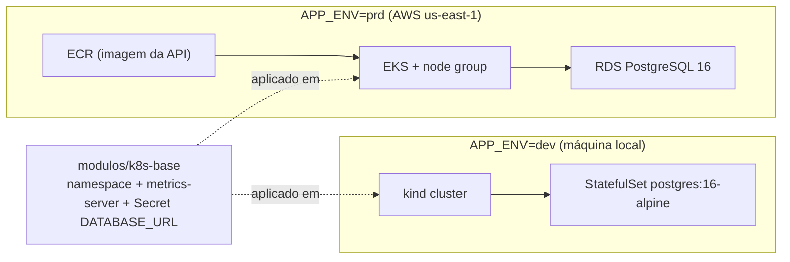

# Infraestrutura como Código (Terraform)

Scripts Terraform que provisionam o **cluster Kubernetes** e o **banco de dados** da API Oficina
Mecânica. Os manifests da aplicação (Deployment, Service, HPA, ConfigMap) ficam em `/k8s`; este
diretório entrega o cluster pronto para recebê-los.

Existem dois ambientes, selecionados pelo `APP_ENV`:

| `APP_ENV` | Cluster | Banco | State | Uso |
|---|---|---|---|---|
| `dev` | kind (Kubernetes em containers Docker, na máquina local) | PostgreSQL 16 em StatefulSet no próprio cluster | Local (`terraform.tfstate`) | Desenvolvimento e testes dos manifests, custo zero |
| `prd` | Amazon EKS + node group | Amazon RDS PostgreSQL 16 | S3 (com lock nativo) | Ambiente na AWS Academy |

Cada ambiente é um diretório próprio em `envs/`, com seu state e seus providers. O código comum
fica em `modulos/`.



## Estrutura

```
infra/
├── modulos/
│   ├── cluster-kind/    # cluster local (provider tehcyx/kind)
│   ├── cluster-eks/     # EKS, node group, access entry e security group
│   ├── database-k8s/    # Postgres em StatefulSet + Service + volume persistente
│   ├── database-rds/    # RDS PostgreSQL, subnet group e security group
│   └── k8s-base/        # namespace, metrics-server (HPA) e Secret com a DATABASE_URL
└── envs/
    ├── dev/             # APP_ENV=dev → kind + database-k8s + k8s-base
    └── prd/             # APP_ENV=prd → cluster-eks + database-rds + ECR + k8s-base
```

Cada módulo segue a estrutura `main.tf` / `variables.tf` / `outputs.tf`.

## Recursos criados

### `dev`

| Recurso | Descrição |
|---|---|
| `kind_cluster` | Cluster `oficina-dev` com 1 control-plane e 1 worker. O NodePort `30080` é publicado em `localhost:8080` |
| `kubernetes_namespace_v1` | Namespace `oficina` |
| `helm_release` metrics-server | Métricas de CPU/memória para o HPA (com `--kubelet-insecure-tls`, exigido pelo kind) |
| `kubernetes_stateful_set_v1` + `kubernetes_service_v1` | Postgres 16 acessível em `postgres.oficina.svc.cluster.local:5432`, com volume de 1Gi |
| `kubernetes_secret_v1` `postgres-credentials` | Usuário, senha e nome do banco usados pelo Postgres |
| `kubernetes_secret_v1` `oficina-db` | `DATABASE_URL` para a API |
| `random_password` | Senha do banco, gerada pelo Terraform (não fica no repositório) |

### `prd`

| Recurso | Descrição |
|---|---|
| `aws_eks_cluster` | Cluster `oficina-prd`, usando a `LabRole` e as subnets da VPC default (exceto `us-east-1e`, sem suporte do EKS) |
| `aws_eks_node_group` | Node group `NG-oficina-prd`: `t3.medium`, de 1 a 2 nós, disco de 50 GB |
| `aws_eks_access_entry` + `aws_eks_access_policy_association` | Acesso de admin ao cluster para a role `voclabs` (a role de quem usa a AWS Academy) |
| `aws_security_group` `SG-oficina-prd` | Security group adicional do control plane |
| `aws_db_instance` | RDS PostgreSQL 16, `db.t3.micro`, 20 GB gp3, criptografado e sem acesso público |
| `aws_db_subnet_group` + `aws_security_group` `SG-oficina-prd-db` | Porta 5432 liberada apenas para o security group dos nós do EKS |
| `aws_ecr_repository` | Repositório `oficina-prd-api` para a imagem da API |
| `kubernetes_namespace_v1`, metrics-server, Secret `oficina-db` | Os mesmos do `dev`, via `modulos/k8s-base` |
| `random_password` | Senha do RDS |

## Pré-requisitos

| Ferramenta | `dev` | `prd` |
|---|---|---|
| Terraform >= 1.10 | ✔ | ✔ |
| Docker em execução | ✔ | — |
| kubectl | ✔ | ✔ |
| kind CLI (para `kind load docker-image`) | ✔ | — |
| AWS CLI v2 (também usado na autenticação do provider Kubernetes) | — | ✔ |

## Variáveis e credenciais

Nenhuma variável do Terraform é obrigatória: todas têm default em `variables.tf`, com a descrição
de cada uma. Para mudar algum valor, copie `terraform.tfvars.example` para `terraform.tfvars`
(ignorado pelo Git) e edite.

O que precisa ser obtido fora do repositório:

| Valor | Onde conseguir | Ambiente |
|---|---|---|
| `AWS_ACCESS_KEY_ID`, `AWS_SECRET_ACCESS_KEY`, `AWS_SESSION_TOKEN` | AWS Academy → Learner Lab → **Start Lab** → **AWS Details** → **AWS CLI: Show**. Expiram quando a sessão do lab termina; a cada novo Start Lab é preciso copiá-las de novo (como variáveis de ambiente ou em `~/.aws/credentials`) | `prd` |
| Nome do bucket do state | Escolhido por você no passo 2 do `prd`. O nome precisa ser único em todo o S3, ex.: `oficina-tfstate-<seu-usuario>` | `prd` |
| `roleName` | `voclabs` na AWS Academy. Confira com `aws sts get-caller-identity`: o ARN mostra `assumed-role/voclabs/...` | `prd` |
| Senha do banco | Não é informada: o Terraform gera. Para consultar a URL completa: `kubectl get secret oficina-db -n oficina -o jsonpath="{.data.DATABASE_URL}" \| base64 -d` | `dev` e `prd` |

O Terraform não lê o `.env` da raiz do projeto, que é usado apenas pelo `docker compose`. O
`APP_ENV` também não é lido pelo Terraform nem pela API: é uma variável do shell que só escolhe o
diretório em `envs/`.

## Como aplicar

Defina o ambiente e use o diretório correspondente:

```bash
export APP_ENV=dev          # ou prd
cd infra/envs/$APP_ENV
```

No Windows (PowerShell): `$env:APP_ENV = "dev"; cd infra/envs/$env:APP_ENV`.

### `dev` (local)

```bash
terraform init
terraform fmt -check -recursive ../..
terraform validate
terraform plan
terraform apply

# kubeconfig do cluster
terraform output -raw kubeconfig > kubeconfig-dev.yaml
export KUBECONFIG=$PWD/kubeconfig-dev.yaml
kubectl get nodes

# imagem da API dentro do cluster (o kind não puxa imagens locais sozinho)
docker build -t oficina-api:dev ../../..
kind load docker-image oficina-api:dev --name oficina-dev
```

Para remover tudo: `terraform destroy`.

### `prd` (AWS Academy)

1. Inicie o lab e copie as credenciais em **AWS Details**. Elas expiram ao fim da sessão:

   ```bash
   export AWS_ACCESS_KEY_ID=...
   export AWS_SECRET_ACCESS_KEY=...
   export AWS_SESSION_TOKEN=...
   ```

2. Crie, uma única vez, o bucket do state. Ele fica fora do Terraform porque precisa existir antes do `init`:

   ```bash
   aws s3 mb s3://<nome-do-bucket> --region us-east-1
   ```

3. Aplique:

   ```bash
   terraform init -backend-config="bucket=<nome-do-bucket>"
   terraform validate
   terraform plan
   terraform apply        # leva de 15 a 20 minutos (EKS + RDS)

   # configura o kubectl
   $(terraform output -raw kubeconfigCommand)
   kubectl get nodes
   ```

4. **Ao terminar, rode `terraform destroy`.** O EKS, os nós e o RDS consomem crédito da AWS Academy enquanto existem.

## Outputs

| Output | `dev` | `prd` | Uso |
|---|---|---|---|
| `clusterName` | ✔ | ✔ | Nome do cluster |
| `namespace` | ✔ | ✔ | Namespace onde aplicar os manifests |
| `databaseSecretName` | ✔ | ✔ | Secret com a `DATABASE_URL` |
| `databaseHost` | ✔ | ✔ | Host do banco |
| `kubeconfig` (sensível) | ✔ | — | `terraform output -raw kubeconfig` |
| `apiUrl` | ✔ | — | URL da API no localhost |
| `loadImageCommand` | ✔ | — | Comando para carregar a imagem no kind |
| `kubeconfigCommand` | — | ✔ | Comando `aws eks update-kubeconfig` |
| `clusterEndpoint` | — | ✔ | Endpoint da API do Kubernetes |
| `ecrRepositoryUrl` | — | ✔ | Destino do `docker push` no CI |

## Contrato com os manifests em `/k8s`

O Terraform cria a base, e os manifests consomem estes valores:

| Item | Valor | Quem cria |
|---|---|---|
| Namespace | `oficina` | Terraform |
| Secret da conexão com o banco | `oficina-db`, chave `DATABASE_URL` | Terraform |
| metrics-server | instalado em `kube-system` | Terraform |
| Service da API (dev) | `type: NodePort`, `nodePort: 30080` → `http://localhost:8080` | `/k8s` |
| Imagem da API | dev: `oficina-api:<tag>` via `kind load`; prd: `ecrRepositoryUrl:<tag>` | CI / `/k8s` |
| Demais segredos (ex.: `JWT_SECRET_KEY`) | Secret próprio dos manifests | `/k8s` |

Exemplo de uso no Deployment:

```yaml
envFrom:
  - secretRef:
      name: oficina-db
```

## Observações

- **Senhas:** são geradas com `random_password` e ficam apenas no state. No `prd`, o state fica
  no S3; no `dev`, fica no `terraform.tfstate` local, que está no `.gitignore`.
- **Providers Kubernetes/Helm configurados a partir do cluster:** funciona no primeiro `apply`. Se o
  cluster precisar ser recriado, aplique em duas etapas:
  `terraform apply -target=module.cluster` e depois `terraform apply`.
- **AWS Academy:** não é possível criar roles IAM. Por isso o cluster e os nós usam a `LabRole`
  existente (`data "aws_iam_role"`), e a rede é a VPC default (`data "aws_vpc"`).
- **Versões:** providers fixados por intervalo compatível em `providers.tf`. Os
  `.terraform.lock.hcl` estão versionados com hashes para Windows, Linux e macOS.

## Referências

- [Documentação do provider AWS (hashicorp/aws)](https://registry.terraform.io/providers/hashicorp/aws/latest/docs): referência usada para os recursos `aws_eks_cluster`, `aws_eks_node_group`, `aws_eks_access_entry`, `aws_eks_access_policy_association`, `aws_db_instance`, `aws_db_subnet_group`, `aws_security_group`, `aws_ecr_repository` e os data sources de VPC, subnets e IAM
- [Provider Kubernetes (hashicorp/kubernetes)](https://registry.terraform.io/providers/hashicorp/kubernetes/latest/docs)
- [Provider Helm (hashicorp/helm)](https://registry.terraform.io/providers/hashicorp/helm/latest/docs)
- [Provider kind (tehcyx/kind)](https://registry.terraform.io/providers/tehcyx/kind/latest/docs)
- [Backend S3](https://developer.hashicorp.com/terraform/language/backend/s3)
- [Chart do metrics-server](https://github.com/kubernetes-sigs/metrics-server/tree/master/charts/metrics-server)
- Material da disciplina FIAP POSTECH SOAT, Fase 2, aulas 1 a 9 (Terraform)
